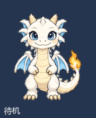
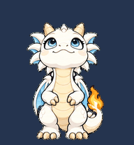
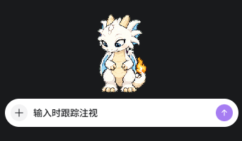

# 霜焰 · Frostflame

白色卡通小龙，适用于支持第二版自定义宠物的 Codex 桌面应用。
自创形象；本项目为社区作品。



## 动作

待机时轻微呼吸、眨眼与尾焰摆动；拖拽时飞行；悬停时喷火；思考时托腮。
具体动作触发由应用版本决定。预览展示图集动作，不代表所有客户端触发方式一致。

## 输入跟踪与视线变化

输入时，小龙会低头注视输入区域，配合视线变化产生陪伴感。下图循环展示图集中已有的 16 个视线方向；这是动作素材演示，实际输入跟踪由应用驱动。



实际使用截图：



## 安装

1. 下载仓库 ZIP 并解压，找到同时包含 `pet.json` 和 `spritesheet.png` 的 `frostflame` 文件夹。
2. 将整个文件夹复制到下面的宠物目录，避免多嵌套一层。已有同名宠物时先备份。
3. 在应用的宠物设置中刷新，选择“霜焰”；没有出现时完全退出应用后重新打开。

| 环境 | 安装目录 |
| --- | --- |
| Windows 默认 | `%USERPROFILE%\.codex\pets\frostflame` |
| macOS / Linux 默认 | `~/.codex/pets/frostflame` |
| 自定义数据目录 | `<CODEX_HOME>/pets/frostflame` |

`CODEX_HOME` 是 Codex 数据目录环境变量；未设置时默认 `~/.codex`。
应使用目标 Codex 应用实际使用的数据目录，不需要为了安装宠物新设或修改该变量。
`${CODEX_HOME:-$HOME/.codex}` 是 shell 中“优先取 CODEX_HOME，否则使用默认目录”的写法，并非字面文件夹名称。

安装后目录示例：

```text
.codex/pets/frostflame/
├── pet.json
└── spritesheet.png
```

宠物制作仓库可以存放在任意位置，运行时加载的安装副本需位于上述目录。
本地宠物包安装与 Pets 插件上传属于不同方式，不应将本项目文件夹当作远端宠物编号使用。

## 格式与兼容性

透明 PNG，1536 × 2288 像素，8 列 × 11 行，每格 192 × 208。
配置必须保留 `spriteVersionNumber: 2`。后两行包含 16 个视线方向。
本包面向支持第二版的本地宠物加载器，不保证适用于网页上传入口或所有旧版本。

## 规范来源

- [Codex 官方数据目录说明](https://developers.openai.com/codex/config-advanced#config-and-state-locations)
- 本机官方 `hatch-pet` 技能的 `references/codex-pet-contract.md`：规定 `pets/<pet-name>/pet.json` 与图集布局。
- [官方 Pets 使用说明](https://learn.chatgpt.com/docs/pets)

## 许可

沿用仓库已有的 MIT License，详见 [LICENSE](LICENSE)。
